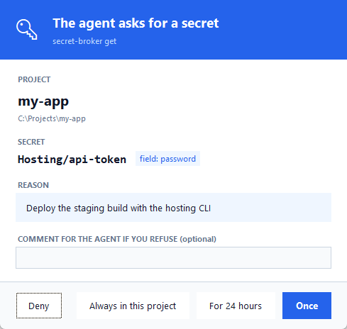
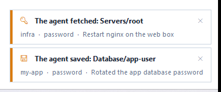
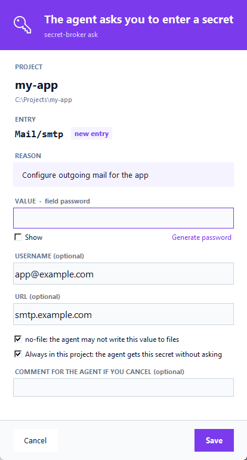
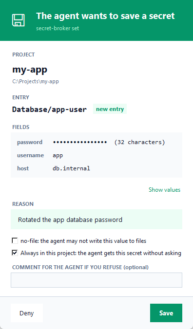
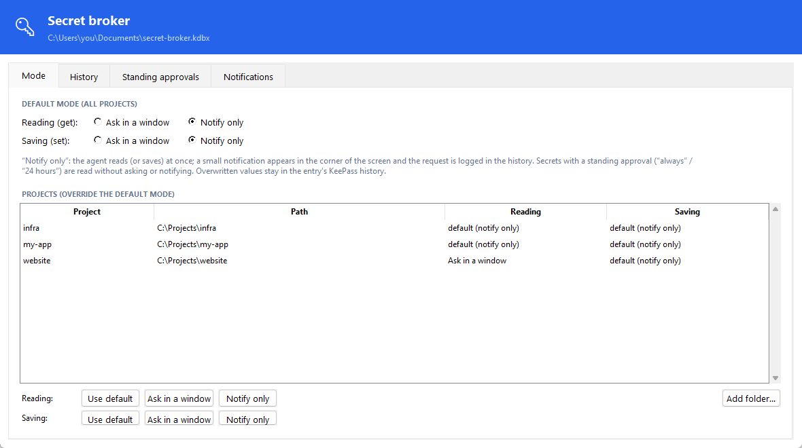
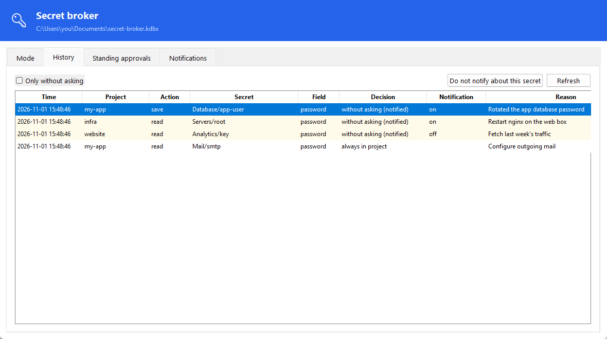

# Magic Secret Broker

Give AI coding agents (Claude Code, Codex, Copilot CLI, Cursor…) the passwords and API keys they need **without pasting them into the chat or leaving them in `.env` files**.

Secrets live in a KeePass (`.kdbx`) vault. The agent sees only entry names and runs a small CLI; each time it asks for a value, you decide in a window: once, for 24 hours, always in this project, or deny. If that is too many windows, switch a project (or everything) to **notify-only mode**: the agent gets the value at once and you get a small, silent notification in the corner of the screen and a history entry. Saving can work the same way.

Windows only (Credential Manager, tray icon). UI in English and Polish (picked from the Windows display language).

 

## Why

Agents need credentials to deploy, query databases or call APIs. The usual options are bad: secrets pasted into the conversation end up in transcripts, `.env` files get committed, and an agent with your whole password store has no reason to ask. secret-broker keeps one vault you control, asks before releasing anything, and logs every access.

## Install

Requires [uv](https://docs.astral.sh/uv/) and PowerShell 7.

```powershell
git clone https://github.com/tobiaxor/magic-secret-broker
pwsh magic-secret-broker/scripts/install.ps1
secret-broker init        # create a vault; you type the master password in a window
```

The installer creates a venv in `~/.claude/tools/secret-broker/.venv` (dependencies pinned with hashes), writes `secret-broker` and `secret-broker.cmd` to `~/.local/bin` (add it to `PATH`), and puts a `secret-broker tray` shortcut in the Startup folder. You can also use an existing vault: point `vault` in the config (below) at it.

To teach your agent the workflow, copy [`skill/SKILL.md`](skill/SKILL.md) into its skills folder (Claude Code: `~/.claude/skills/secret-broker/SKILL.md`) or paste its rules into your `AGENTS.md` / `CLAUDE.md`.

## Usage

```bash
secret-broker list [--json]                          # entry names (Group/Title) and fields, no values
secret-broker get NAME [--field FIELD] [--reason "why"]
secret-broker set NAME [--stdin | --generate [LEN]] [--field FIELD] [--username U] [--url U] [--attr K=V]... [--no-file] [--reason "why"]
secret-broker ask NAME [--field FIELD]... [--username U] [--url U] [--attr K=V]... [--no-file] [--print] [--reason "why"]
secret-broker mode [prompt|notify|default] [--global | --project PATH] [--write]
secret-broker approvals [--revoke NAME [--project PATH]]
secret-broker tray                                   # tray icon: mode, history, approvals
secret-broker init
secret-broker forget [--reason "why"]                # remove the remembered master password
secret-broker delete NAME [--reason "why"]           # move an entry to the Recycle Bin (always asks)
```

The agent fetches a value inside the command that uses it, so it never sits in a file or a shell variable between calls:

```bash
curl -H "Authorization: Bearer $(secret-broker get "Hosting/api-token" --reason "deploy staging")" https://api.example.com/deploy
```

The *project* is the directory the command runs from; a linked git worktree counts as its main repository.

Exit codes: `0` OK, `1` denied or cancelled, `2` missing entry or field, `3` vault locked or missing, `4` forbidden (`no-file` value redirected to a file).

### Windows

| | |
|---|---|
| **`get`** asks: **Once**, **For 24 hours**, **Always in this project** or **Deny**. Nothing is asked when an approval already exists. Buttons arm after 0.8 s and Enter approves nothing, so a stray keypress cannot grant access. You can leave a comment for the agent when you deny ("use the test key"); it is printed on stderr. |  |
| **`ask`** lets *you* type a secret the agent needs (an API key from a web console). The agent supplies only the name, reason and username/URL hints. "Always in this project" is ticked for a new entry: untick it if the agent should ask before reading it. |  |
| **`set`** saves a value the agent produced (a generated or rotated password) after you confirm. Changed fields are marked; the previous version stays in the entry's KeePass history. |  |

**`delete`** moves an entry to the vault's Recycle Bin after you confirm, and revokes its approvals in every project. It always asks: neither notify mode nor an "always" approval covers a deletion. Restore or empty the bin in KeePassXC.

`init`, unlocking and `forget` have their own windows. With **Remember** ticked, the master password and derived key go to Windows Credential Manager, so later calls do not ask for it.

### Notify-only mode and the tray icon

In `notify` mode a secret without a standing approval is released at once, and a small card slides into the bottom-right corner with the secret, project, field and reason. It makes no sound, never takes the keyboard focus and fades out after a few seconds (hover to keep it). Click it to open the history at that request. If the tray icon cannot be started, the broker falls back to the approval window. Secrets with an "always" or "24 hours" approval never ask and never notify.


Reading (`get`) and saving (`set`) have separate modes, each with a global default and per-project overrides. In saving notify mode the agent creates and overwrites entries without the confirmation window; the previous value stays in the entry's KeePass history. Set the modes in the tray window or with `secret-broker mode` (`--write` for saving). Turning notify mode **on** from the command line opens a confirmation window, because an agent could run that command; turning it off does not.

The tray icon (amber with a red dot while a global default is `notify`) opens a window with:

- **Mode**: reading and saving modes, globally and per project;
- **History**: every read, save and approval, with the decision and reason. Select a row (or right-click it) to turn notifications for that secret off or on;
- **Standing approvals**, which you can revoke;
- **Notifications**: show a card for every secret except the ones turned off, or only for the ones turned on (say, root and admin accounts). Every use is still logged either way. There is no command-line switch for this, so an agent cannot silence its own notifications.




### `no-file` secrets

Tag an entry `no-file` (KeePass *Tags* field, or the checkbox in the `set`/`ask` windows) when its value must never be written to a file. `get` refuses to redirect it to a file (exit 4) and the `guard-hook` subcommand, installed as a Claude Code `PreToolUse` hook (matcher `Write|Edit|MultiEdit|NotebookEdit|Bash|PowerShell`), blocks file writes and redirecting shell commands that contain such a value. The hook stores only HMACs of values it has seen. Writes to the temp folder and to git-ignored files inside a temporary linked worktree are allowed.

## Configuration

`~/.claude/secret-broker/config.json` (all keys optional):

```json
{
  "vault": "C:/Users/you/Documents/secret-broker.kdbx",
  "keyfile": null,
  "backup_task": "\\MyTasks\\BackupVault",
  "lang": "en"
}
```

| Key | Default | |
|---|---|---|
| `vault` | `~/Documents/secret-broker.kdbx` | the KeePass file |
| `keyfile` | none | KeePass key file |
| `backup_task` | none | Windows scheduled task run after each vault write (e.g. an off-site copy) |
| `lang` | Windows display language | `en` or `pl` |

Environment variables `SECRET_BROKER_KDBX`, `SECRET_BROKER_KEYFILE`, `SECRET_BROKER_BACKUP_TASK` and `SECRET_BROKER_LANG` override the file. `SECRET_BROKER_STATE` (state folder) is honoured only together with `SECRET_BROKER_KDBX`, for tests.

The state folder holds `approvals.json`, `approvals_day.json`, `settings.json`, `audit.jsonl` and `no_file.json`; none of them contain secret values. Back up only the `.kdbx` file. Each write keeps the previous vault as `<vault>.bak`, which may contain rotated-out secrets.

## Security model

secret-broker protects against a **well-meaning but mistaken agent**: it keeps secrets out of the agent's context until needed, makes every access visible (approval window, notification, audit log) and catches common accidents (the `no-file` redirect check and `guard-hook`).

It is **not** a security boundary against an agent that runs arbitrary commands as your Windows user, for example after a prompt injection. Such a process can:

- read the remembered master password from Windows Credential Manager and open the vault directly, with no window and no log entry;
- edit the approval, settings and audit files, run from another project's directory, or click the approval window;
- stop or impersonate the tray icon, or replace the broker's scripts, venv or shims.

The audit log and notifications are informational, not tamper-proof. `no-file` is a lint for mistakes: encoded, split or indirect writes are not detected. Approvals cover a whole entry (all its fields), not a single field. The reason text comes from the agent; read it critically, and never type your master password into an `ask` window.

Any value an agent receives becomes part of the model context and the session transcript. For real isolation, run the agent under a separate OS account or in a sandbox without access to your desktop session, Credential Manager and `~/.claude/secret-broker`. If your agent runner supports it, deny agent writes to the state folder, the venv, the shims and this repository. Do not tick **Remember** if you do not accept these risks.

Report vulnerabilities as described in [SECURITY.md](SECURITY.md).

## License

[MIT](LICENSE)
